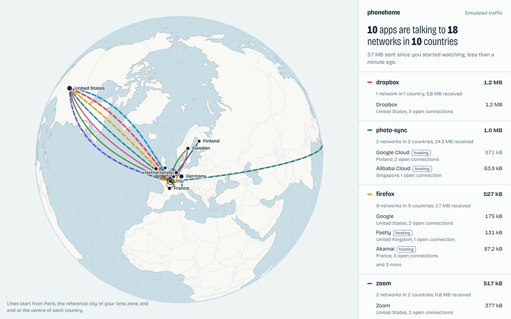

<div align="center">

# phonehome

**See which apps on your machine phone home, and to whom.**

One binary, no root, no account. Open the page and watch your computer talk.

[](https://github.com/mxbhr/phonehome/actions/workflows/ci.yml)


**[▶ Open the live demo](https://mxbhr.github.io/phonehome/)** (simulated traffic)

<a href="https://mxbhr.github.io/phonehome/"></a>

</div>

## What it answers

Your laptop is never silent. `phonehome` lists every application holding a connection to the Internet and tells you, for each one:

- **which networks it reaches**, by name: Google, Meta, Cloudflare, a hosting company you have never heard of
- **in which countries**
- **how much it sent** since you started watching (Linux)

Each application gets its own line colour on the globe. Dashes travel along a line while bytes are leaving.

## Install

```bash
cargo install --git https://github.com/mxbhr/phonehome
phonehome
```

The page opens at `http://127.0.0.1:4747`. On first run, two location databases (about 20 MB) are downloaded to your data directory; `phonehome update` refreshes them.

```
phonehome                    watch this machine
phonehome --include-local    also show LAN and loopback traffic
phonehome --demo             simulated traffic, same as the online demo
phonehome snapshot           watch for 3 seconds, print JSON, exit
phonehome --offline          never touch the network
```

## How it works

```
 kernel socket table ──► collector ──► tracker ──► http://127.0.0.1:4747 ──► globe
   (netlink sock_diag)    1 poll/s     per-app      own HTTP server           canvas
                                       totals
```

**Collector (Linux).** No packet capture and no root. `phonehome` speaks `NETLINK_SOCK_DIAG` to the kernel, the interface behind `ss`, and asks for every TCP and UDP socket together with its `tcp_info`. That structure carries cumulative byte counters per socket; the tracker turns them into per-application totals by adding only the growth between two polls. Sockets are matched to processes through their inode in `/proc/<pid>/fd`. The netlink messages are built and parsed by hand in [`src/collector/linux.rs`](src/collector/linux.rs).

**Collector (macOS, Windows).** Reads the OS socket table. TCP only, connection counts instead of bytes.

**Who and where.** Each address is looked up in two local MaxMind-format databases: country and autonomous system. Around fifty well-known networks get a plain name and a `hosting` flag, because data sent to AWS or Cloudflare is stored or relayed *for* another company.

**Server.** A small HTTP/1.1 server written on `std::net`, bound to `127.0.0.1` only. It checks the `Host` header on every request, so a web page cannot reach it through DNS rebinding and read your connection list.

**Interface.** Plain JavaScript, a canvas, and `d3-geo`. Everything is embedded in the binary: the page loads no font, script or tile from the Internet. A privacy tool should not phone home.

## What it does not tell you

- **Locations are per country**, drawn at the country's centre, and come from IP registries. They are often wrong for global networks that announce the same addresses worldwide.
- **A network is not a recipient.** "Amazon AWS" means the server is hosted there. The company behind it is not visible without decrypting traffic, which this tool never does.
- **Connections shorter than a poll can be missed.** The socket table is read once per second.
- **Other users' processes** show as `unknown` on Linux unless you run as root.
- **macOS and Windows** builds are less complete: no byte counts, no UDP.
- Data already sent before you started watching is not counted.

## Roadmap

- [ ] eBPF collector on Linux: no missed short connections, exact bytes for UDP and QUIC
- [ ] Domain names, from DNS answers seen by the machine
- [ ] History on disk and a daily summary
- [ ] Prebuilt binaries for Linux, macOS and Windows

## Development

```bash
cargo test          # includes a test against the real kernel on Linux
cargo run -- --demo
```

The interface lives in [`web/`](web) and needs no build step.

## Credits

Country database: [geo-whois-asn-country](https://github.com/sapics/ip-location-db) (CC0). ASN database: RouteViews and [DB-IP](https://db-ip.com) (CC BY 4.0), packaged by ip-location-db. Map: [Natural Earth](https://www.naturalearthdata.com) via world-atlas. Country centres: [mledoze/countries](https://github.com/mledoze/countries) (ODbL). Typeface: Bricolage Grotesque (OFL).

## License

MIT © Maxime Behr
